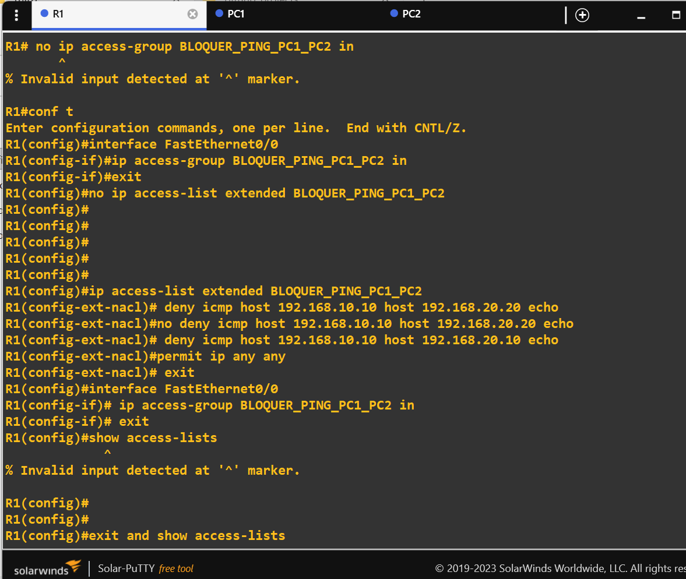
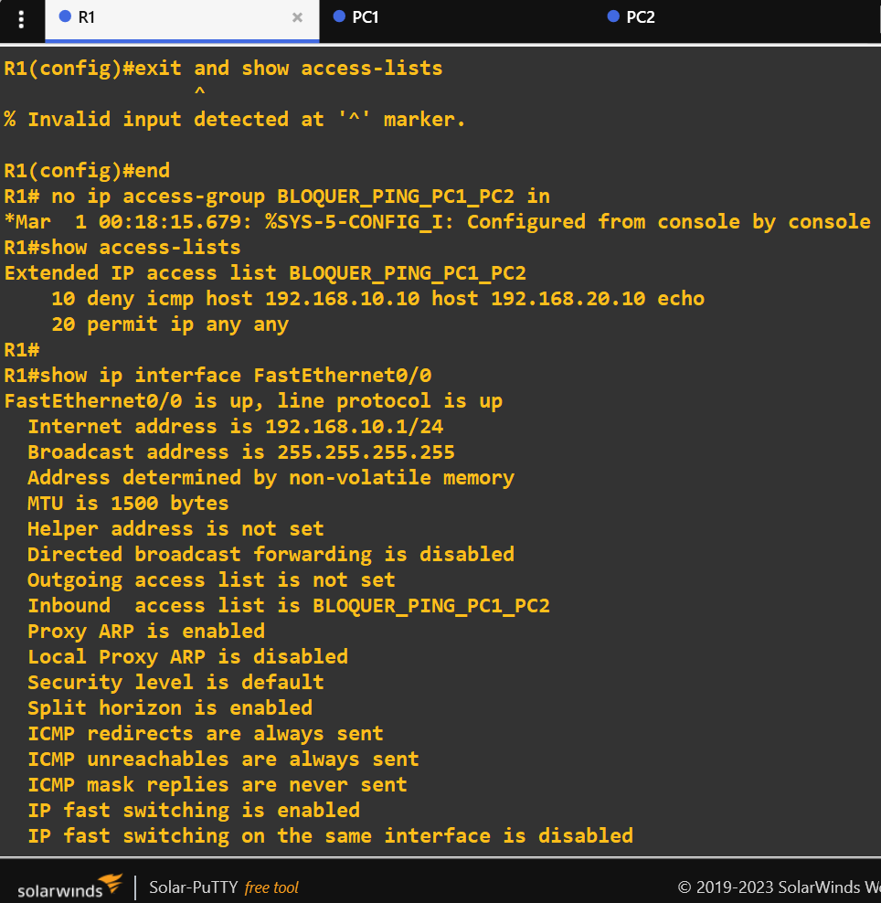
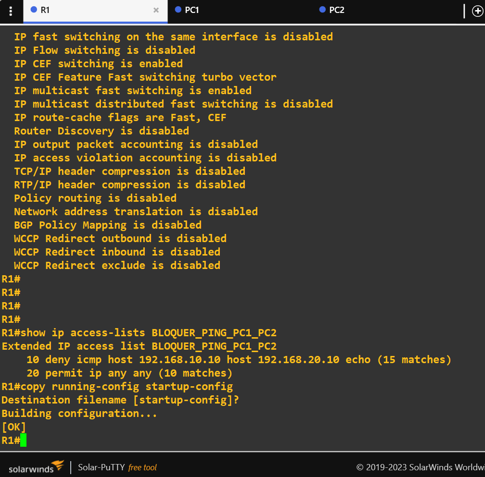
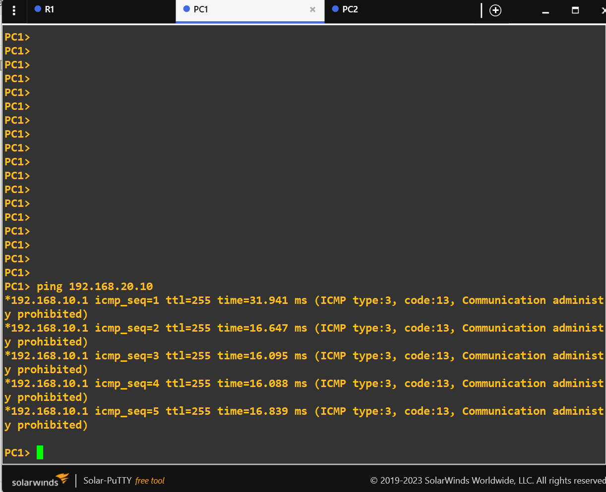
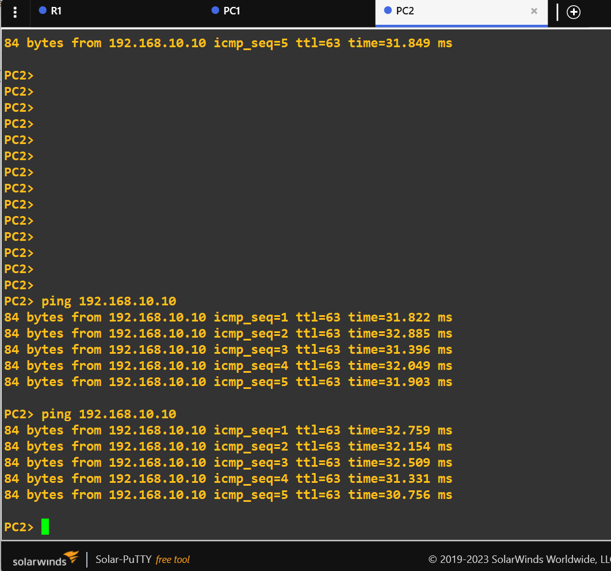

# LAB03 — Filtrage du trafic IPv4 avec une ACL Cisco

## 1. Présentation

Ce laboratoire met en œuvre une liste de contrôle d'accès étendue (ACL) sur un routeur Cisco 2691 émulé dans GNS3.

L'objectif est de contrôler les communications entre deux sous-réseaux IPv4 en bloquant les requêtes ICMP Echo envoyées par PC1 vers PC2, tout en maintenant la possibilité pour PC2 de joindre PC1 par ping.

## 2. Objectifs pédagogiques

- Comprendre le fonctionnement des ACL étendues Cisco.
- Filtrer le trafic selon le protocole, la source et la destination.
- Appliquer une ACL à une interface dans le bon sens.
- Vérifier le comportement du filtrage par des tests de connectivité.
- Examiner les compteurs de correspondances de l'ACL.
- Préparer une évolution vers la journalisation des événements de sécurité.

## 3. Environnement technique

| Élément | Description |
|---|---|
| Système hôte | Windows 11 Professionnel |
| Émulateur | GNS3 2.2.61 |
| Routeur | Cisco 2691 |
| Commutateurs | Switches Ethernet GNS3 |
| Postes clients | VPCS |
| Analyse réseau | Wireshark |

## 4. Topologie et adressage

La topologie reprend le laboratoire précédent : PC1 et PC2 sont situés dans deux sous-réseaux distincts, reliés par le routeur R1.

| Équipement | Adresse IPv4 | Masque | Passerelle |
|---|---|---|---|
| PC1 | 192.168.10.10 | 255.255.255.0 | 192.168.10.1 |
| R1 — FastEthernet0/0 | 192.168.10.1 | 255.255.255.0 | — |
| R1 — interface côté réseau B | 192.168.20.1 | 255.255.255.0 | — |
| PC2 | 192.168.20.10 | 255.255.255.0 | 192.168.20.1 |


## 5. Politique de filtrage

La politique mise en œuvre est volontairement limitée :

- Bloquer les requêtes ICMP Echo de PC1 vers PC2.
- Autoriser les autres paquets IPv4 examinés par cette ACL.
- Ne pas bloquer les requêtes ICMP Echo initiées par PC2 vers PC1.

Cette règle sert à démontrer le filtrage directionnel. Elle ne constitue pas une politique de sécurité complète pour une entreprise.

## 6. Configuration de l'ACL

```text
ip access-list extended BLOQUER_PING_PC1_PC2
 deny icmp host 192.168.10.10 host 192.168.20.10 echo
 permit ip any any
!
interface FastEthernet0/0
 ip access-group BLOQUER_PING_PC1_PC2 in
```

La première règle refuse les requêtes ICMP Echo correspondant aux deux adresses spécifiées.

La seconde autorise les autres paquets IPv4 qui atteignent cette ACL et ne correspondent pas à la règle précédente.

L'ACL est appliquée en entrée sur FastEthernet0/0, l'interface par laquelle arrivent les paquets provenant du réseau de PC1.



## 7. Vérification de la configuration

Commandes utilisées :

```text
show ip access-lists BLOQUER_PING_PC1_PC2
show ip interface FastEthernet0/0
```

La première commande permet d'examiner les règles et leurs compteurs. La seconde permet de vérifier l'application de l'ACL sur l'interface.





## 8. Tests et résultats

| Test | Résultat attendu | Résultat observé |
|---|---|---|
| PC1 vers PC2 par ping | Échec | Bloqué |
| PC2 vers PC1 par ping | Succès | Autorisé |
| Compteur de la règle deny | Augmente après les requêtes bloquées | À documenter par capture |

Les tests confirment que le filtrage cible les requêtes ICMP Echo de PC1 vers PC2, sans empêcher le ping initié dans le sens inverse.





## 9. Limites et précautions

La règle `permit ip any any` autorise les autres paquets IPv4 traités par cette ACL. Elle ne signifie pas que tous les autres protocoles ou services de l'architecture sont sécurisés.

Une ACL sans règles explicites suffisantes peut bloquer d'autres flux en raison du refus implicite final. Toute évolution de la politique doit être testée pour éviter les interruptions de service.

## 10. Améliorations envisagées

Une prochaine étape consistera à ajouter la journalisation sur la règle de refus, si elle est prise en charge par l'image IOS utilisée.

Les événements seront observés dans les journaux du routeur et, si nécessaire, comparés à une capture Wireshark.

## 11. Conclusion

Ce laboratoire démontre la mise en œuvre d'une ACL étendue Cisco pour contrôler un flux IPv4 selon le protocole, l'adresse source et l'adresse destination.

Il permet de passer de la simple connectivité réseau à une première mesure de contrôle d'accès et prépare les travaux suivants sur la journalisation, la surveillance et le durcissement de l'architecture réseau.